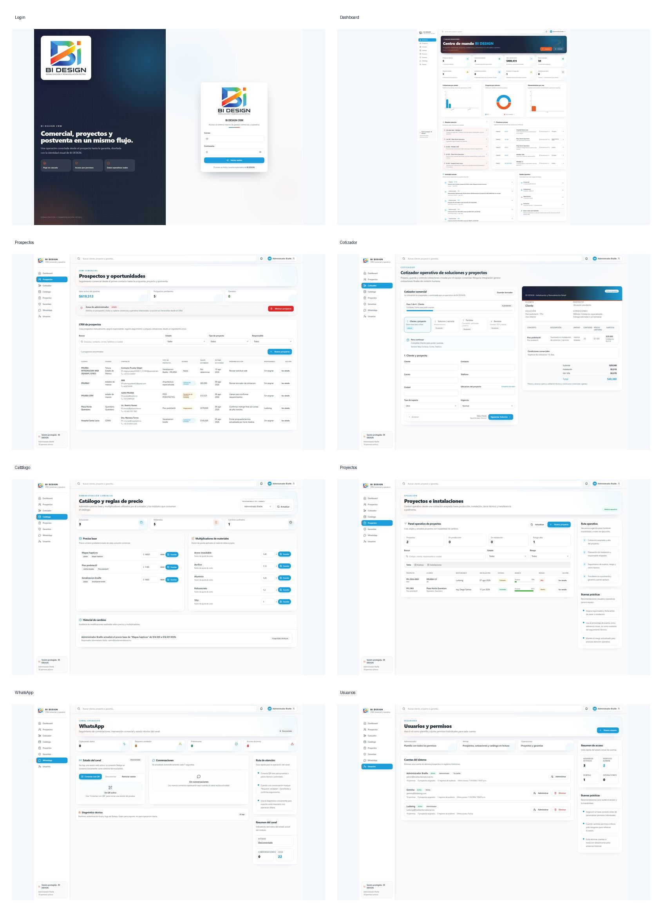

# BI DESIGN CRM

CRM comercial y operativo de **BI DESIGN — Señalización y Remodelación Retail**.

> **Repositorio independiente.** Este proyecto no es el CRM de Braille International y no debe compartir base de datos, secretos, despliegue, identidad visual ni historial Git con ese sistema.

## Estado actual

La base funcional consolidada incluye:

- Dashboard operativo con datos reales.
- Prospectos y oportunidades.
- Cotizador comercial guiado con revisión humana.
- Catálogo y reglas de precio.
- Proyectos e instalaciones.
- Garantías y postventa.
- Usuarios, roles y permisos granulares.
- Canal WhatsApp en estado técnico/piloto.
- Integración Web → CRM para formularios de BI DESIGN.
- Eliminación administrativa en cascada con auditoría.
- Identidad visual y sistema UI/UX propio de BI DESIGN.

### Regla comercial principal

Los formularios, integraciones y automatizaciones pueden capturar, validar, deduplicar y registrar oportunidades, pero **no generan ni envían cotizaciones automáticamente**. La cotización es preparada, revisada y enviada por una persona autorizada.

## Evidencia visual actual

Snapshot visual capturado el **11 de agosto de 2026**:



Capturas individuales:

- `00-login.png`
- `01-dashboard.png`
- `02-prospectos.png`
- `03-cotizador.png`
- `04-catalogo.png`
- `05-proyectos.png`
- `06-whatsapp.png`
- `07-usuarios.png`

## Stack

- Next.js 14
- React + TypeScript
- Tailwind CSS
- Prisma 6
- SQLite
- Vitest
- Node.js 24
- Windows Server en la instancia operativa actual

## Desarrollo local

```bash
npm ci
npx prisma generate
npm run lint
npm run test
npm run build
npm run dev
```

La aplicación utiliza variables de entorno. Copia `.env.example` a `.env` y configura únicamente valores locales.

**Nunca subas `.env`, credenciales, cookies, claves webhook, bases SQLite ni secretos al repositorio.**

## Validación obligatoria

Todo cambio debe superar, como mínimo:

```bash
npm run lint
npm run test
npm run build
```

Los cambios de Prisma requieren revisión adicional y nunca deben utilizar comandos destructivos contra una base con datos reales.

## Estructura

```text
src/
  app/
  components/
  lib/
  modules/
prisma/
docs/
  screenshots/current/
public/
scripts/
```

## Integración Web → CRM

```text
BI DESIGN Web
   ↓
Webhook autenticado
   ↓
Validación + normalización + deduplicación
   ↓
Prospecto con origen WEB
   ↓
Revisión humana
   ↓
Cotización comercial
```

El webhook debe conservar autenticación propia, validación, idempotencia, auditoría y revisión humana.

## Seguridad

- No publicar el puerto interno de Next.js directamente a Internet.
- Producción debe utilizar HTTPS y reverse proxy.
- No versionar archivos SQLite ni respaldos de producción.
- No usar `prisma db push --force-reset`.
- No ejecutar `npm run db:setup` sobre datos operativos.
- No ejecutar seeds destructivos sobre una base real.
- Las operaciones destructivas deben permanecer auditadas.

## Separación del repositorio histórico

La instancia operativa de BI DESIGN nació sobre una carpeta y un historial heredados de otro proyecto. Ese historial **no debe convertirse en el historial Git oficial de BI DESIGN**.

La migración correcta consiste en:

1. validar la instancia operativa;
2. generar un snapshot limpio;
3. excluir `.git`, `.env`, SQLite, logs, secretos, backups y runtime;
4. incorporar el snapshot a `lilpne25-ui/Bi-Design-CRM`;
5. ejecutar lint, tests y build;
6. verificar un clon limpio.

Consulta:

- `docs/CURRENT_STATE.md`
- `docs/REPOSITORY_SEPARATION.md`
- `docs/MIGRATION_GUIDE.md`
- `.agent.md`
- `AGENTS.md`

## Próxima fase

Después de consolidar el código en este repo, la siguiente etapa es **Operational Experience V4**:

- búsqueda global real;
- centro de notificaciones real;
- refinamiento funcional del Cotizador;
- progressive disclosure para acciones destructivas;
- feedback consistente;
- auditoría responsive;
- accesibilidad y navegación por teclado.

## Propiedad

Proyecto de BI DESIGN desarrollado e implementado con soporte de VLUX.
